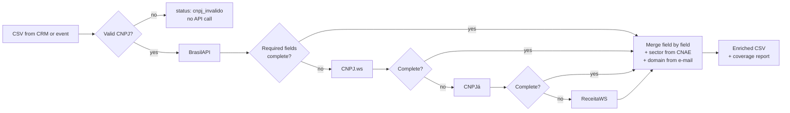

# br-enrichment-waterfall: ICP lists and company enrichment for Brazilian B2B

> **PT-BR:** Do ICP à lista pronta para o CRM, só com dados públicos. Passo 1: filtra a base aberta de CNPJ da Receita Federal pelo seu ICP (CNAE, UF, município, porte, idade, capital) e mede o TAM. Passo 2: enriquece a lista em cascata entre quatro APIs públicas, campo a campo, e diz de onde veio cada dado.

```
baixar_base.py  →  icp_list.py  →  enrich.py  →  CRM
(Receita, mensal)   (ICP + TAM)     (waterfall)
```

**Result of the waterfall** (run on 11 Nov 2026 against the live public APIs, [sample list](data/empresas_exemplo.csv) of 14 rows formatted like a CRM export: 12 large Brazilian companies, one duplicate and one typo):

| Metric | BrasilAPI alone | Waterfall |
| --- | --- | --- |
| Companies with e-mail (and company domain) | 0 of 12 (0%) | 11 of 12 (92%) |
| Required fields filled | 86% | 99% |
| API calls | 12 | 26 of 48 possible (46% avoided by the early stop) |

The mistyped CNPJ in the list was caught before any API call, and the duplicate row was enriched once. Full report: [`exemplos/relatorio_exemplo.md`](exemplos/relatorio_exemplo.md).

## Step 1: build the list from your ICP

The Receita Federal publishes every company in Brazil once a month as open data: about 7 GB of zipped CSVs with CNAE, address, phone, e-mail, size and capital. Most paid prospecting lists are built from this file. `icp_list.py` streams it (about 500 thousand rows per second in tests, no database) and keeps only the companies that match your ICP.

```bash
python baixar_base.py --conjunto icp          # downloads the latest month (~7 GB, resumable)
python icp_list.py dados_receita/2026-10 \
    --cnae 62,6311 --uf SC,PR --porte EPP,DEMAIS --idade-min 2 --excluir-mei \
    -o listas/icp.csv
```

| Filter | Example | Notes |
| --- | --- | --- |
| `--cnae` | `62,6311,7319` | CNAE prefixes; add `--cnae-secundario` to match secondary activities too |
| `--uf`, `--municipio` | `SC,PR` · `Florianópolis,Joinville` | City names are matched without accents |
| `--porte` | `ME,EPP,DEMAIS` | Needs the Empresas files |
| `--idade-min`, `--idade-max` | `2`, `10` | Years since the company opened |
| `--capital-min` | `100000` | Registered capital in R$ |
| `--excluir-mei` | | Removes individual micro-entrepreneurs (needs Simples.zip) |
| `--incluir-filiais`, `--incluir-inativas` | | By default: only active head offices |
| `--ordenar`, `--limite` | `capital`, `500` | Export the top N |

It writes the list (with a `cnpj` column, ready for step 2) and `relatorio_icp.md`: the funnel from the whole base to your TAM, plus the profile of the list by state, size, sector, CNAE and age, and how many have e-mail and phone. To try it without the full download, `python baixar_base.py` fetches one of the ten establishment files (~350 MB) and the lookup tables; size and capital filters need the full set.

## Step 2: enrich in a waterfall

The Receita file is a monthly snapshot, and lists that come from a CRM, an event or a form often have nothing but the CNPJ. `enrich.py` checks each company against live public APIs, completes what is missing and records the source of every field.

### The problem

Brazilian B2B lists arrive messy: CNPJs with and without punctuation, leading zeros lost in Excel, typos, duplicates. Global enrichment tools cover Brazilian companies poorly, and each free CNPJ API returns a different subset of fields. In the run above, BrasilAPI returned no e-mail for any of the 12 companies, while CNPJ.ws had it for 11.

The fix is a waterfall: ask the cheapest, most reliable source first, and only call the next one for the fields that are still missing.

### The system



- **Validation before spend:** CNPJ check digits are verified locally, and zeros lost in spreadsheets are restored (`191` → `00.000.000/0001-91`). Invalid CNPJs never reach an API.
- **Field-level merge:** the first non-empty value wins, in provider order, and every field records which provider filled it (`fontes` column) for auditing.
- **Early stop:** the next provider is called only if a *required* field is still missing. You choose which fields justify another call (`--obrigatorios`).
- **One schema:** each provider has an adapter that normalises names, dates (ISO), phones (E.164), CNAE codes, company size and city names.
- **Derived fields:** `setor` from the CNAE section and `dominio` from the corporate e-mail (free e-mail providers are ignored).
- **Polite and resumable:** per-provider rate limits for the free tiers, retries with back-off on 429/5xx, local cache so re-runs cost nothing, and duplicates in the input are enriched once.

### Output

Original columns plus: `cnpj_formatado`, `razao_social`, `nome_fantasia`, `situacao`, `data_abertura`, `porte`, `natureza_juridica`, `cnae_principal`, `cnae_descricao`, `municipio`, `uf`, `cep`, `telefone`, `email`, `capital_social`, `setor`, `dominio`, `status_enriquecimento` (`completo`, `parcial`, `nao_encontrado`, `cnpj_invalido`), `fontes` and `provedores_consultados`.

See [`exemplos/`](exemplos/) for the CSV and the report from the run above.

### Run it yourself

Python 3.9+ and no dependencies outside the standard library.

```bash
python enrich.py data/empresas_exemplo.csv -o saida/empresas_enriquecidas.csv
```

| Option | What it does |
| --- | --- |
| `--coluna` | Name of the CNPJ column (default: the first column with "cnpj" in its name) |
| `--provedores` | Waterfall order (default: `brasilapi,cnpjws,cnpja,receitaws`) |
| `--obrigatorios` | Fields that justify calling the next provider (default: `razao_social,situacao,cnae_principal,municipio,uf,telefone,email`) |
| `--sem-cache` | Ignore the local `.cache/` folder |

The CSV can be comma or semicolon separated (Excel in Brazil uses `;`). Free tiers allow only a few requests per minute on some providers, so large lists take time; the cache lets you stop and resume.

## Web app and API (Vercel)

The whole flow also runs as a web app, on a Python serverless API in `api/`. No dependencies, no environment variables.

- `index.html`: from the ICP to the enriched list. Pick UF, city, CNAE, size, age, capital and "exclude MEI"; the page finds the companies in the Receita base through the open search of [Minha Receita](https://docs.minhareceita.org/como-usar/), adds what the Receita record already has (partners with role, age range and entry year; full address; secondary CNAEs; Simples), completes the contacts in the waterfall (CNPJ.ws → CNPJá → ReceitaWS) and downloads the CSV. No file upload.
- `lista.html`: already have the CNPJs? Paste or upload them, see the source of each field, download a CSV.

| Route | What it does |
| --- | --- |
| `GET /api/enrich?cnpj=47.960.950/0001-21` | Enriches one CNPJ. Optional: `&obrigatorios=email,telefone`, `&provedores=brasilapi,cnpjws` |
| `POST /api/enrich` | Body `{"cnpjs": [...], "obrigatorios": [...], "provedores": [...]}`, up to 10 CNPJs per call |
| `GET /api/info` | Describes the API (health check) |
| `GET /api/buscar?uf=SC&cnae=6201501&porte=ME,EPP&quero=25` | Step 1 on the web: companies that match the ICP (active head offices by default; also `municipio` (IBGE code), `cnae_secundario`, `excluir_mei`, `idade_min`, `capital_min`, `cursor`) |
| `POST /api/enriquecer` | Step 2 for one company found by `/api/buscar`: `{"cnpj": "...", "registro": {...}, "ultimas": {...}}`. `ultimas` carries the time of the last call to each provider, so the page respects the free limits across function instances |

Response of `GET` (one item of `resultados` in `POST`):

```json
{
  "cnpj": "47.960.950/0001-21",
  "status": "completo",
  "dados": {"razao_social": "MAGAZINE LUIZA S/A", "email": "...", "dominio": "magazineluiza.com.br", "setor": "Comércio", "...": "..."},
  "fontes": {"razao_social": "brasilapi", "email": "cnpjws", "setor": "derivado:cnae_principal"},
  "provedores_consultados": ["brasilapi", "cnpjws"]
}
```

`POST` also returns `pendentes` (CNPJs left out when a call gets close to the function's time limit; send them again) and `chamadas` (API calls per provider). CORS is open, so any front-end can call it.

**Deploy:** import this repository in Vercel with the default settings (framework preset "Other"); `vercel.json` sets a 300-second limit for `api/enrich.py`. **Run locally:** `python dev_server.py` and open http://localhost:8000.

Limits to keep in mind: the free APIs allow only a few calls per minute, so send small batches (the page sends 5 at a time) and expect about 20 seconds per company that needs a second provider. The cache lives in `/tmp` and only survives while a function instance is warm. On the web, step 1 uses Minha Receita's search (experimental, it may answer 429) instead of the ~7 GB Receita download, and filters the rest (status, head office, size, MEI, age, capital) in the function; `icp_list.py` stays the way to measure the full TAM locally.

## Tests

45 tests run offline: the waterfall on real responses recorded from the four APIs, the ICP builder on files in the Receita's official layout, and the API (enrichment, ICP search and web enrichment) on a local HTTP server.

```bash
python -m unittest discover -s tests
```

## Data and LGPD

All sources are public registry data from the Receita Federal. Some companies register a person's e-mail or phone, which is personal data under the LGPD: use it only with a legal basis (for B2B prospecting, usually legitimate interest), offer an opt-out, and do not resell it. In the published example, the part of e-mails before the `@` is masked.

## What I'd do next

- Push the result to HubSpot as an idempotent upsert keyed by CNPJ.
- Add paid providers at the end of the waterfall (company website, LinkedIn, headcount) for the fields public data does not have.
- ICP scoring (fit score) instead of hard filters.
