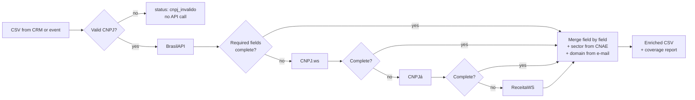

# br-enrichment-waterfall: company enrichment for Brazilian B2B lists

> **PT-BR:** Enriquecimento de listas de empresas brasileiras a partir do CNPJ, em cascata entre quatro APIs públicas e gratuitas. Valida o CNPJ, completa campo a campo, para assim que o registro está completo e entrega um CSV pronto para o CRM com a origem de cada dado.

**Result** (run on 11 Nov 2026 against the live public APIs, [sample list](data/empresas_exemplo.csv) of 14 rows formatted like a CRM export: 12 large Brazilian companies, one duplicate and one typo):

| Metric | BrasilAPI alone | Waterfall |
| --- | --- | --- |
| Companies with e-mail (and company domain) | 0 of 12 (0%) | 11 of 12 (92%) |
| Required fields filled | 86% | 99% |
| API calls | 12 | 26 of 48 possible (46% avoided by the early stop) |

The mistyped CNPJ in the list was caught before any API call, and the duplicate row was enriched once. Full report: [`exemplos/relatorio_exemplo.md`](exemplos/relatorio_exemplo.md).

## The problem

Brazilian B2B lists arrive messy: CNPJs with and without punctuation, leading zeros lost in Excel, typos, duplicates. Global enrichment tools cover Brazilian companies poorly, and each free CNPJ API returns a different subset of fields. In the run above, BrasilAPI returned no e-mail for any of the 12 companies, while CNPJ.ws had it for 11.

The fix is a waterfall: ask the cheapest, most reliable source first, and only call the next one for the fields that are still missing.

## The system



- **Validation before spend:** CNPJ check digits are verified locally, and zeros lost in spreadsheets are restored (`191` → `00.000.000/0001-91`). Invalid CNPJs never reach an API.
- **Field-level merge:** the first non-empty value wins, in provider order, and every field records which provider filled it (`fontes` column) for auditing.
- **Early stop:** the next provider is called only if a *required* field is still missing. You choose which fields justify another call (`--obrigatorios`).
- **One schema:** each provider has an adapter that normalises names, dates (ISO), phones (E.164), CNAE codes, company size and city names.
- **Derived fields:** `setor` from the CNAE section and `dominio` from the corporate e-mail (free e-mail providers are ignored).
- **Polite and resumable:** per-provider rate limits for the free tiers, retries with back-off on 429/5xx, local cache so re-runs cost nothing, and duplicates in the input are enriched once.

## Output

Original columns plus: `cnpj_formatado`, `razao_social`, `nome_fantasia`, `situacao`, `data_abertura`, `porte`, `natureza_juridica`, `cnae_principal`, `cnae_descricao`, `municipio`, `uf`, `cep`, `telefone`, `email`, `capital_social`, `setor`, `dominio`, `status_enriquecimento` (`completo`, `parcial`, `nao_encontrado`, `cnpj_invalido`), `fontes` and `provedores_consultados`.

See [`exemplos/`](exemplos/) for the CSV and the report from the run above.

## Run it yourself

Python 3.9+ and no dependencies outside the standard library.

```bash
python enrich.py data/empresas_exemplo.csv -o saida/empresas_enriquecidas.csv
```

| Option | What it does |
| --- | --- |
| `--coluna` | Name of the CNPJ column (default: the first column with "cnpj" in its name) |
| `--provedores` | Waterfall order (default: `brasilapi,cnpjws,cnpja,receitaws`) |
| `--obrigatorios` | Fields that justify calling the next provider (default: `razao_social,situacao,cnae_principal,municipio,uf,telefone,email`) |
| `--sem-cache` | Ignore the local `.cache/` folder |

The CSV can be comma or semicolon separated (Excel in Brazil uses `;`). Free tiers allow only a few requests per minute on some providers, so large lists take time; the cache lets you stop and resume.

Tests run offline, on real responses recorded from the four APIs:

```bash
python -m unittest discover -s tests
```

## Data and LGPD

All sources are public registry data from the Receita Federal. Some companies register a person's e-mail or phone, which is personal data under the LGPD: use it only with a legal basis (for B2B prospecting, usually legitimate interest), offer an opt-out, and do not resell it. In the published example, the part of e-mails before the `@` is masked.

## What I'd do next

- Push the result to HubSpot as an idempotent upsert keyed by CNPJ.
- Add paid providers at the end of the waterfall (company website, LinkedIn, headcount) for the fields public data does not have.
- ICP scoring from CNAE, size, age and location.
